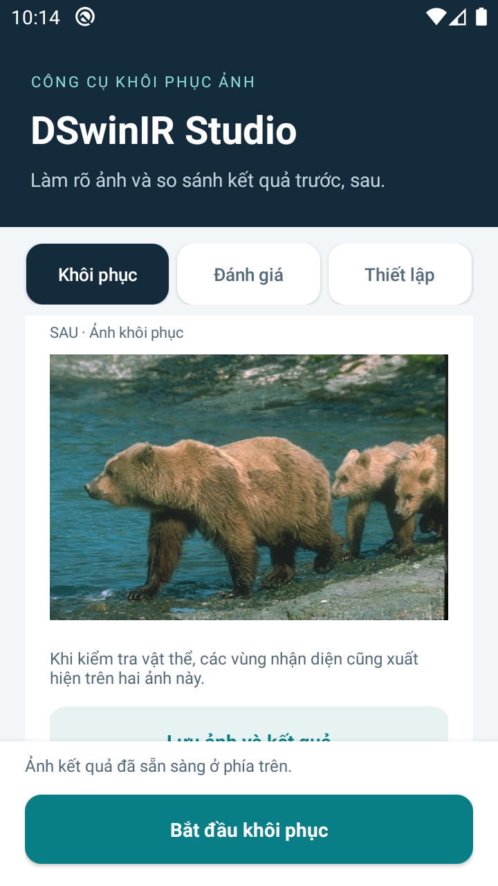

# DSwinIR Android Lab

Đã có app Android 10+, ba model TFLite FP32 đã kiểm tra đầu ra trên Android 10 và 15 ảnh test có nguồn rõ ràng. App hỗ trợ ghép tile 256×256, benchmark CPU/GPU với 5 warm-up + 50 lần đo, YOLO detection và instance segmentation độc lập.

**Chưa hoàn thành thí nghiệm mAP đủ năm tác vụ:** checkpoint tìm được là Rain100L **đơn tác vụ**, bộ ảnh chưa có nhãn bbox/mask, và chưa đo benchmark 5+50 trên điện thoại có GPU. Không coi kết quả kiểm tra số học là kết quả chất lượng của bài báo.

## Nội dung repository public

Repository chứa mã nguồn Android, công cụ chuyển đổi, các mô hình giả nhỏ dùng cho kiểm thử thành phần và báo cáo kiểm chứng. **Không chứa trọng số đã huấn luyện, model TFLite thật, bộ ảnh test đầy đủ, APK hoặc bộ máy ảo**. Các đường dẫn tới những tệp này bên dưới là đường dẫn đầu ra trên máy sau khi tải/chuyển đổi, không phải tệp đã đưa lên GitHub.

- Build app: cài Java 17, Android SDK 37; đặt `ANDROID_HOME` trỏ tới SDK rồi mở thư mục `android/` bằng Android Studio hoặc dùng lệnh bên dưới.
- Tải checkpoint Rain100L: cài `gdown` và PyTorch rồi chạy `sh download_weights.sh`. Chuyển đổi theo mục **Chuyển đổi và kiểm chứng** hoặc notebook Colab.
- Hai model nhận diện được tạo bằng `convert/prepare_yolo.py` và `convert/convert_yolo.py`.
- Tải ảnh thử và tạo bộ kiểm tra theo mục **Bộ thử 15 ảnh**.
- App có thể build khi chưa có model. Để khôi phục/nhận diện, cài các tệp model ở mục **Thiết lập** trong app.

Nguồn mã và mô hình tham khảo: [THIRD_PARTY.md](THIRD_PARTY.md).

## Chạy ngay trong Antigravity

Mở workspace này, nhấn **Cmd+Shift+B** để chạy task **Android: Build và chạy DSwinIR**. Task build mã nguồn hiện tại, mở cửa sổ emulator Android10 rồi cài/mở app. Không cần mở Android Studio.

Hoặc chạy trong terminal tích hợp:

```sh
sh tools/run_android.sh
```

Muốn mở nhanh APK đã build: `sh tools/run_android.sh --apk`. Có thể chọn task này qua Command Palette → Tasks: Run Task → Android: Mở APK có sẵn. Emulator hiển thị ở cửa sổ riêng; Antigravity dùng để sửa code, build và điều khiển chạy. Task mặc định không xóa dữ liệu của máy ảo hoặc đổi model người dùng đã nhập.

## Mở và chạy

Mở `android/` bằng Android Studio, dùng Java 17 và SDK 37, Gradle Sync rồi Run. `minSdk=29` (Android 10). Có thể build bằng:

```sh
cd android
./gradlew :app:assembleDebug :app:testDebugUnitTest :app:lintDebug
```

APK: `android/app/build/outputs/apk/debug/app-debug.apk`.

| File để nhập vào app | Tác dụng |
|---|---|
| `convert/prepared256/dswinir_256_fp32.tflite` | Khôi phục RGB, FP32, 256×256; checkpoint Rain100L single-task |
| `convert/yolo/detection/yolo11n_fp32.tflite` | COCO80 object detection, input 640×640 |
| `convert/yolo/segmentation/yolo11n-seg_fp32.tflite` | COCO80 instance segmentation, input 640×640 |
| `deliverables/testset-15-unlabelled.zip` | Ba ảnh test mỗi suy thoái, chưa có nhãn object |

Chép các file sang điện thoại rồi nhập bằng các nút tương ứng. Chọn ảnh → Khôi phục CPU/GPU → xem ảnh gốc và ảnh khôi phục. Hai nút YOLO chạy detection và segmentation riêng. Với ZIP chưa có nhãn, dùng **Khôi phục tập ảnh ZIP**; app chặn mAP khi `annotation_status=pending`, không biến ảnh chưa gán nhãn thành ảnh negative.

Chọn suy thoái chỉ ghi metadata, không đổi trọng số. Dùng Rain100L single-task trên noise/haze/blur/low-light là thử ngoài phân phối, **không tái lập checkpoint five-task**.

Benchmark đo tile đầu 256×256, warm-up đúng 5 lần, đo 50 lần và hiện trung bình trong app. JSON xuất đủ samples, thiết bị, hash model và log. Chỉ xác nhận full/partial GPU khi có bằng chứng runtime; không xuất hiện thì N/A, thiếu log thì UNKNOWN. Số luồng CPU là `max(1, min(4, số lõi khả dụng - 1))` (máy ảo 2 lõi dùng 1 luồng); DSwinIR tắt XNNPACK vì đã quan sát OOM do hàng trăm partition trên emulator 2 GB; YOLO dùng cấu hình tối ưu riêng. Thời gian native parity trong log chỉ là từng lần invoke, **không phải** benchmark 5+50.

## Bộ thử 15 ảnh

| Suy thoái | Nguồn và lựa chọn |
|---|---|
| Noise | CBSD68 từ FFDNet của Kai Zhang; ba ảnh đầu theo tên; Gaussian σ=25, seed 42–44, round/clip PNG uint8 cho mobile |
| Rain | Rain100L test ZIP được repo DSwinIR liên kết; rain-001/002/003 và ảnh sạch tương ứng |
| Haze | RESIDE SOTS outdoor từ trang tác giả; ba scene đầu; JPEG nguồn giải mã rồi lưu PNG lossless |
| Blur | GoPro test từ archive do tác giả liên kết; một frame từ mỗi sequence đầu trong ba sequence khác nhau |
| Low-light | Ba ảnh trong `data/eval/low` của RetinexNet tác giả; repo subset không có ảnh sạch kèm theo |

Danh sách, nguồn từng file, SHA-256, seed và phạm vi thử nằm trong `data/pilot/manifest.json`. Có 12 cặp ảnh sạch kèm theo; ảnh sạch không phải nhãn object. Quy ước PNG noise là pilot cho mobile, chưa khẳng định trùng protocol float của bài báo.

Tải lại và đóng gói:

```sh
PYTHONPATH=.export-deps python3 tools/download_pilot.py
python3 tools/pack_testset.py data/pilot/manifest.json --out deliverables/testset-15-unlabelled.zip --require-five-tasks --allow-unlabelled
```

Để đo mAP, gán nhãn đúng COCO class 0..79 theo [schema](docs/testset-format.json), bỏ trạng thái pending sau khi kiểm chứng. Không dùng dự đoán YOLO làm ground truth. Protocol AP101, IoU .50:.05:.95 được mô tả trong [trạng thái triển khai](docs/implementation-status.md); chưa hỗ trợ đầy đủ crowd/ignore/area của COCOeval.

## Chuyển đổi và kiểm chứng

```sh
PYTHONPATH=.export-deps python3 convert/prepare_tf_weights.py --checkpoint weights/rain100l_official.pth --out convert/prepared256 --size 256
venv/bin/python convert/direct_tf.py --prepared convert/prepared256
```

Đường mới PyTorch → TensorFlow → TFLite builtins, không Flex, không quantization. Attention chia nhóm nhỏ, giữ rank ≤5 cho phần slice và tránh bias bị constant-fold thành bảng không gian lớn. Chỉ ghi model sau khi hai fixture đều đạt max absolute error ≤1e-3. [Notebook Colab](convert/DSwinIR_Colab.ipynb) dùng source bundle từ `python3 tools/package_conversion.py`; notebook chưa được chạy trên tài khoản Google của người dùng.

YOLO dùng Ultralytics 8.3.221, output raw normalized xywh, `nms=False`. `convert/prepare_yolo.py` tạo ONNX và reference; `convert/convert_yolo.py` chuyển TFLite, chuẩn hóa layout output cho app và chặn file nếu parity không qua. Source và môi trường chính xác nằm trong báo cáo chuyển đổi.

Các lỗi LayerNorm/offset/biên NATTEN của port cũ đã được sửa. Không dùng fixture/log cũ trong `convert/out/` làm bằng chứng chất lượng. Vẫn cần đối chiếu với CUDA NATTEN gốc và cấu hình huấn luyện tác giả trước khi khẳng định tái lập bài báo.

## Giao diện và cách dùng

- **Khôi phục**: chọn ảnh, bấm **Bắt đầu khôi phục**, xem ảnh trước/sau và lưu kết quả. Nút bắt đầu nằm cố định ở cuối màn hình; khi xong app cuộn đến ảnh kết quả.
- **Đánh giá**: tìm và khoanh vật thể, tô vùng từng vật thể, chấm điểm bộ ảnh có đáp án đúng, hoặc đo tốc độ chuyên sâu.
- **Thiết lập**: cài công cụ khôi phục và hai công cụ nhận diện từ tệp model.

Tác vụ nặng có nút **Dừng xử lý**, thời gian đã chờ và tiến độ từng lượt. Phép đo 5 lần chạy thử + 50 lần đo cần xác nhận trước khi chạy; dừng giữa chừng không tạo kết quả benchmark hoàn chỉnh. Ảnh và báo cáo của phiên gần nhất được lưu trên thiết bị để mở lại sau khi khởi động app.

Trên máy ảo, khôi phục có thể kéo dài nhiều phút. Launcher tắt Vulkan của máy ảo; cấu hình hiển thị này không chứng minh khả năng chạy LiteRT trên GPU điện thoại. Nếu cửa sổ ghi “leave trackball mode”, thoát chế độ đó bằng ⌘T trên máy Mac đã kiểm tra.



## Kiểm chứng

Xem [danh mục bằng chứng](docs/verification/README.md) để biết từng báo cáo chứng minh điều gì và giới hạn tương ứng. Thư mục này giữ các báo cáo chuyển đổi, sai số trên Android, kiểm thử thành phần, ảnh trước/sau và kiểm thử dừng model thật.

Các kiểm tra hiện có **chưa chứng minh mAP tăng, hiệu năng GPU điện thoại hoặc chất lượng đủ năm tác vụ**. Xem [trạng thái triển khai](docs/implementation-status.md) cho protocol và công việc còn thiếu.

## Cấu trúc mã nguồn

- `android/`: app, Gradle wrapper và kiểm thử Android.
- `convert/`: chuẩn bị trọng số, chuyển TensorFlow/TFLite, chuyển YOLO và notebook Colab.
- `tools/`: chạy máy ảo, chuẩn bị ảnh thử, đóng gói và kiểm chứng.
- `model.py`, `natten_pure.py`, `validate_model.py`, `tests/`: bản port PyTorch và kiểm tra toán học.

Các nhánh chuyển đổi DSwinIR qua ONNX/TorchScript cũ, demo YOLO đếm vật thể và ảnh/log trùng đã được loại khỏi Git. Trên máy phát triển, bản gốc nằm trong `.local-archive/` (được ignore), có danh sách tệp và SHA-256 để khôi phục. Hai script ONNX của YOLO vẫn là một phần của luồng chuyển đổi hiện tại.
